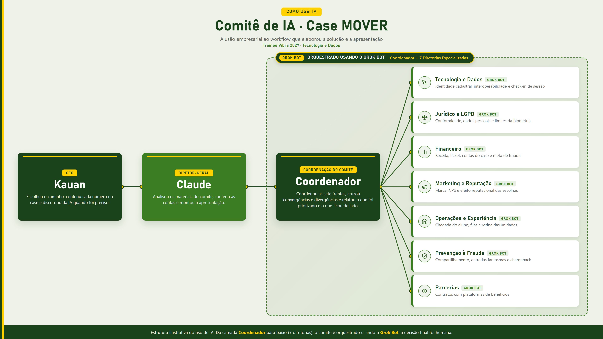

# Case MOVER: Tecnologia e Dados (Trainee Vibra 2027)

Este repositório reúne a apresentação e o documento analítico que desenvolvi para a etapa de painel com gestores do Programa Trainee Vibra 2027, na vertical de Tecnologia e Dados.

O desafio parte da MOVER, uma rede fictícia de academias que cresceu comprando quatro concorrentes regionais e hoje opera cerca de 180 unidades em sete estados. O crescimento por aquisições deixou cinco sistemas de gestão (ERPs) que não conversam entre si. O conselho pede visão única do aluno e redução da perda com fraude e chargeback pela metade (de 3,8% para 1,9% da receita) em 12 meses, sem piorar o tempo de fila na portaria nem o NPS, além de um resultado mensurável em 90 dias e uma decisão sobre o contrato da maior plataforma agregadora em quatro meses.

## O diagnóstico e as contas a partir do case

Os 410 mil alunos ativos reportados pela empresa são a soma bruta dos cinco cadastros. O próprio case admite entre 12% e 20% de duplicidade, o que coloca a base real entre 328 mil e 361 mil pessoas únicas (49 mil a 82 mil registros excedentes). Sem identificar quem passa na catraca, a empresa falha na promessa de permitir treino em qualquer unidade e tampouco consegue separar quanto dos 3,8% de perda vem de plano compartilhado, entrada fantasma ou cobrança contestada.

Cruzando os números do enunciado, fiz duas contas que orientam a decisão comercial e tecnológica:

1. Alunos vindos de plataformas agregadoras (como Wellhub e TotalPass) representam 33% da base, mas geram apenas 19% da receita, pagando R$ 14 por visita contra R$ 129 da mensalidade direta média. Pela proporção `(19 / 33) / (81 / 67) * 129`, o aluno de plataforma deixa cerca de R$ 61,43 por mês na academia, o equivalente a 4,4 visitas mensais (48% da receita de um aluno direto, que exigiria 9,2 visitas para empatar). Ainda assim, romper esse contrato de forma abrupta cortaria 19% da receita da empresa da noite para o dia para combater uma perda de 3,8%.
2. O piloto de reconhecimento facial em três unidades reduziu a fraude local em 45%, abaixo dos 80% prometidos pelo fornecedor, e trouxe fila nos horários de pico, bloqueios indevidos em parte do público e questionamentos jurídicos pela LGPD. Aplicado na rede inteira, esse corte de 45% deixaria a perda residual em 2,09% da receita (acima da meta de 1,9%) e custaria 1,5% do faturamento anual, sobrando um ganho líquido de apenas 0,21 ponto percentual no primeiro ano.

## O caminho escolhido e o que fica para trás

A solução descarta a expansão do reconhecimento facial neste ciclo e desliga o teste das três unidades até o dia 60. Em vez de trocar os cinco ERPs em 12 meses ou instalar câmeras na rede, o plano cria uma camada leve de identidade cadastral sobre os cinco sistemas existentes, unificando o aluno pelo CPF, combinada a um check-in de sessão com código dinâmico de uso único e validade de poucos segundos na catraca. Para os horários de pico e alunos sem celular na mão, a portaria opera com um fluxo de contingência auditável.

Para atingir a meta de 1,9% em 12 meses, três frentes rodam em paralelo a partir da medição de baseline no dia 28:

| Tipo de perda | Mecanismo aplicado |
| :--- | :--- |
| Plano compartilhado | Regra de velocidade (uma identidade só mantém uma sessão aberta por vez) e token temporário de uso único vinculado ao CPF e à unidade |
| Entrada fantasma | Validador na catraca conectado à camada de identidade e registro de presença atrelado ao token de sessão |
| Cobrança contestada (chargeback) | Conciliação automática de cobranças e repasses, dossiê de presença por visita e roteiro padronizado (playbook) de contestação |

Na negociação de quatro meses com a maior plataforma, a renovação exige que o parceiro envie um identificador único do beneficiário no momento do check-in. Se a plataforma recusar, a MOVER aciona um acordo-ponte de quatro meses com saída automática, sem incluir unidades novas nem ampliar o volume anônimo, usando esse prazo para migrar os alunos para planos diretos ou para outro agregador. Quem não migrar ao fim da transição deixa de entrar por esse benefício.

Quanto aos sete pilotos de inteligência artificial espalhados pela rede, todos ficam pausados nos primeiros 90 dias. Após esse marco, entra em operação um único projeto desenhado junto com os professores de sala: um alerta simples quando a frequência individual do aluno cai ou acumula dias sem treino, cabendo ao professor fazer o contato humano.

### Projeção financeira em dois anos

Considerando a receita anual estimada entre R$ 420 milhões (piso de 328 mil alunos únicos) e R$ 525 milhões (teto nominal de 410 mil registros), manter o patamar atual de 3,8% representa perder de R$ 32,0 milhões a R$ 39,9 milhões acumulados em dois anos.

Com a entrada gradual das alavancas no primeiro ano e a operação completa no segundo:

- Em um cenário conservador (queda até 2,8%, caso a maior parte da perda seja contestação de alunos aparentemente legítimos), a perda cai para a faixa de R$ 25,7 milhões a R$ 32,0 milhões no biênio, preservando entre R$ 6,3 milhões e R$ 7,9 milhões no caixa.
- Batendo a meta de 1,9%, a perda cai para R$ 20,0 milhões a R$ 25,0 milhões em dois anos, evitando entre R$ 12,0 milhões e R$ 15,0 milhões em perdas antes do custo da solução.

## Como usei inteligência artificial e onde discordei dela

Para explorar o problema sob diferentes ângulos de negócio sem cair em respostas genéricas, montei um comitê multiagente no Grok Bot com sete especialistas simulando diretorias da empresa (Tecnologia e Dados, Jurídico e LGPD, Financeiro, Marketing, Operações, Prevenção a Fraude e Parcerias), mediados por um bot Coordenador que mapeou convergências e conflitos. Em seguida, utilizei o Claude para revisar a consistência matemática e estruturar o recorte executivo.

Revisando o material gerado pelos modelos, tomei cinco decisões diferentes das recomendações originais da IA:

1. O comitê não havia calculado a frequência implícita do aluno de plataforma; derivei a média de 4,4 visitas mensais a partir do mix de 33% de alunos e 19% de receita.
2. A IA sugeriu entregar apenas diagnóstico e números de baseline no marco de 90 dias; antecipei a entrada em produção das alavancas nas ~20 unidades críticas para o dia 60, levando ao conselho no dia 90 uma redução já medida contra grupo de controle.
3. O relatório inicial deixava em aberto o destino das câmeras nas três unidades de teste e tratava a meta de 1,9% como hipótese não certificada; assumi o desligamento do facial até o dia 60 e mantive 1,9% como meta de execução.
4. O comitê havia tratado o procedimento do Wellhub de exigir denúncia de fraude só após a visita como se fosse um dado escrito no enunciado do case; separei o que era fato do case do que era evidência externa de mercado.
5. A recomendação técnica pedia o congelamento total de projetos de IA por 12 meses; optei por retomar um único piloto após o dia 90 focado em alerta de queda de frequência para ação do professor.

## Referências utilizadas

### Mercado fitness e plataformas agregadoras

- InvestNews (17/06/2025): [De influencers a Ozempic: o que está por trás do crescimento do mercado fitness no Brasil](https://investnews.com.br/negocios/de-influencers-a-ozempic-o-que-esta-por-tras-do-crescimento-do-mercado-fitness-no-brasil/)
- Fitness Brasil: [Panorama Setorial Fitness Brasil 2024](https://www.fitnessbrasil.com.br/newsfitbr/descubra-as-tendencias-do-mercado-fitness-em-2024-uma-analise-completa-do-panorama-setorial-fb/)
- Diário do Nordeste (28/05/2025): [Apps de bem-estar abocanham mercado fitness e apertam academias menores no Ceará (regra prática de mix do Sindfit-CE)](https://diariodonordeste.verdesmares.com.br/negocios/apps-de-bem-estar-abocanham-mercado-fitness-e-apertam-academias-menores-no-ceara-1.3654100)
- Cade (18/12/2025): [Cade homologa novo TCC com a Wellhub](https://www.gov.br/cade/pt-br/assuntos/noticias/cade-homologa-novo-tcc-com-wellhub-gympass)
- Cade (21/09/2022): [Gympass celebra acordo com o Cade no mercado de academias](https://www.gov.br/cade/pt-br/assuntos/noticias/gympass-celebra-acordo-com-o-cade-no-mercado-de-academias-de-ginasticas-no-brasil)
- VEJA (12/09/2025): [Nunca seremos donos de academia, diz presidente do Wellhub no Brasil](https://veja.abril.com.br/economia/nunca-seremos-donos-de-academia-diz-presidente-do-wellhub-no-brasil/)
- Wellhub Partner Academy: [Reportar comportamentos suspeitos](https://wellhub.com/pt-br/partner-academy/reportar-comportamentos-suspeitos/)
- Suporte Wellhub / Gympass: [Como parceiros podem reportar um visitante](https://support.gympass.com/hc/pt-br/articles/43621714617619-Como-parceiros-podem-reportar-um-visitante)
- Suporte Wellhub / Gympass: [Por que é necessário o reconhecimento facial no momento do check-in](https://support.gympass.com/hc/pt-br/articles/45639853727379-Por-que-%C3%A9-necess%C3%A1rio-o-reconhecimento-facial-no-momento-do-check-in)
- TotalPass: [Termos de uso](https://totalpass.com/br/terms/)
- Sistema Pacto: [Como é feito o cadastro automático do aluno TotalPass no primeiro check-in](https://sistemapacto.zendesk.com/hc/pt-br/articles/56614209472531-Como-%C3%A9-feito-o-cadastro-autom%C3%A1tico-do-aluno-TotalPass-no-primeiro-check-in)

### Proteção de dados, regulação e biometria facial

- Planalto: [Lei nº 13.709/2018 (Lei Geral de Proteção de Dados Pessoais, LGPD)](https://www.planalto.gov.br/ccivil_03/_ato2015-2018/2018/lei/l13709.htm)
- Autoridade Nacional de Proteção de Dados, ANPD (02/06/2025): [ANPD abre tomada de subsídios sobre tratamento de dados biométricos](https://www.gov.br/anpd/pt-br/assuntos/noticias/anpd-abre-tomada-de-subsidios-sobre-tratamento-de-dados-biometricos)
- Autoridade Nacional de Proteção de Dados, ANPD (18/02/2025): [ANPD fiscaliza reconhecimento facial em 23 clubes de futebol](https://www.gov.br/anpd/pt-br/assuntos/noticias/anpd-fiscaliza-uso-de-sistema-de-reconhecimento-facial-na-venda-de-ingressos-e-na-entrada-de-estadios-por-23-clubes-de-futebol)
- Autoridade Nacional de Proteção de Dados, ANPD: [Biometria é tema do segundo volume da série Radar Tecnológico](https://www.gov.br/anpd/pt-br/assuntos/noticias/biometria-e-tema-do-segundo-volume-da-serie-radar-tecnologico)
- Instituto Brasileiro de Defesa do Consumidor, Idec (12/06/2025): [Guia completo: sistema de reconhecimento facial](https://idec.org.br/dicas-e-direitos/guia-completo-sistema-de-reconhecimento-facial)
- National Institute of Standards and Technology, NIST: [FRTE Demographics (efeitos demográficos no reconhecimento facial)](https://pages.nist.gov/frvt/html/frvt_demographics.html)
- National Institute of Standards and Technology, NIST (12/2019): [NISTIR 8280: Face Recognition Vendor Test (FRVT) Part 3, Demographic Effects](https://nvlpubs.nist.gov/nistpubs/ir/2019/NIST.IR.8280.pdf)

### Estudos sobre frequência e retenção em academias

- Revista Brasileira de Ciências do Esporte, RBCE / SciELO: [Dropout predictors at gyms: a retrospective study](https://www.scielo.br/j/rbce/a/WtzM3gBFRkcrqY7xKZsVNnm/)
- International Journal of Environmental Research and Public Health, IJERPH / PMC (2021): [Predicting Fitness Centre Dropout](https://pmc.ncbi.nlm.nih.gov/articles/PMC8508547/)
- Psychology of Sport and Exercise (2020): [Why do new members stop attending health and fitness venues? The importance of developing frequent and stable attendance behaviour](https://doi.org/10.1016/j.psychsport.2020.101771)

## Arquivos deste repositório

- [`MOVER_Apresentacao_Trainee_Vibra_v13.pptx`](MOVER_Apresentacao_Trainee_Vibra_v13.pptx): Apresentação executiva em PowerPoint (14 slides principais com notas de apresentador para 7 minutos e 1 slide de apêndice com as fontes externas).
- [`case-mover-diagnostico-caminho-projecao.md`](case-mover-diagnostico-caminho-projecao.md): Documento analítico consolidado pelo comitê de agentes no Grok Bot, detalhando fatos do case, contas derivadas, referências regulatórias (LGPD, ANPD, Idec, NIST), estudos de retenção e matriz de convergências e divergências entre as sete áreas.

## Autor

Kauan Christofaro  
Graduando em Sistemas de Informação na Universidade Federal Fluminense (UFF) e Analista de BI e Dados.  
Contato: [kauanchristofaro@gmail.com](mailto:kauanchristofaro@gmail.com) | [LinkedIn](https://www.linkedin.com/in/kauan-christofaro-0a98b412a/)
